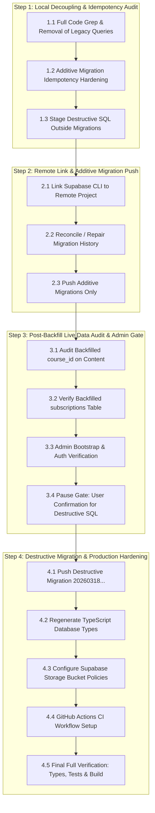

# Implementation & Architecture Roadmap: Belajar Bareng Nata (BBN)

> **Document Status:** Phases 0A through 2 completed, verified, and committed. Phase 3 & 4 execution plan prepared.  
> **Repository:** `bbn-website` (`c:\Users\p\.gemini\antigravity\scratch\bbn-website`)  
> **Tech Stack:** Next.js 16.1 (App Router, Turbopack), React 19, TypeScript, Tailwind CSS, Supabase (PostgreSQL, Auth, Storage, RLS), Vitest.

---

## Part 1: Previous Phases Execution & Verification Results

### 1.1 Milestone Audit & Git Commit Trail

| Commit | Scope / Phase | Description & Verified Impact |
| :--- | :--- | :--- |
| `770727a` | **Step -1 (Baseline Snapshot)** | Captured the uncommitted 19 dirty files before starting production refactoring. |
| `6a754cd` | **Phase 0A (Security Lockdown)** | Backdoor deletion, Supabase Auth admin migration, fail-closed proxy, PII centralization, remote storage whitelisting, account lockout prevention. |
| `7707d95` | **Phase 0B, 0C, 0D (Supabase Layer & UI)** | Total removal of Prisma, non-recursive RLS `public.is_admin()`, dynamic `courses` and unified `subscriptions` table, `src/lib/entitlements.ts`, Soft Cream/Olive token unification. |
| `d2f7371` | **Phase 1 & Phase 2 (CBT & Notes Reader)** | Anti-exploit CBT scoring, timer stale-closure fix, database-backed results/history, interactive study notes reader (`/dashboard/materi/[slug]`) with LaTeX display scroll & sticky TOC, freemium barrier, admin split-pane live editor, wired access modal. |
| `61d22f9` | **Step A (Code Decoupling & Additive Migration)** | Complete code-first decoupling of `user_subject_access` and legacy user columns, submissions-backed tryout quotas (`getTryoutQuota`), `rehype-sanitize` XSS protection, `20260317100000_cbt_and_materials_extension.sql`, role detachment from enum, and 41/41 Vitest tests. |

---

### 1.2 Summary of Completed Fixes & Enhancements

#### Phase 0A — Security Lockdown & PII Centralization
- **Backdoor Removal:** Deleted the unauthenticated database wipe/seed endpoint `src/app/api/seed/route.ts`.
- **Admin Auth Migration:** Retired the separate env password JWT cookie system (`admin_session`). Standardized admin authentication on Supabase Auth (`users.role = 'ADMIN'`). Implemented server-side `requireAdmin()` guard reading the Supabase SSR session and injected it at the entry point of all 14 `/api/admin/**` route handlers and `/api/auth/approve`.
- **Fail-Closed Security Proxy:** Fixed `src/proxy.ts` so that missing environment variables trigger HTTP 503 instead of failing open with `NextResponse.next()`. Protected `/admin` routes via Supabase Auth session validation.
- **Single-Source Business & Pricing Configuration:**
  - Created `src/config/business.ts` centralizing SeaBank, GoPay, WhatsApp admin URL, and Brevo email parameters.
  - Created `src/config/plans.ts` establishing the authoritative pricing catalog:
    - `FREE`: Free preview access (Module 1 notes, diagnostic sample tryout).
    - `MONTHLY`: Rp 49.000 (strike-through Rp 79.000), 30 days active access.
    - `SEMESTER`: Rp 129.000 (strike-through Rp 199.000), 180 days active access.
    - Offline tutoring (Rp 55k / 205k / 380k) designated as marketing cards with direct WhatsApp CTAs.
- **Account Lockout & Bypasses Prevented:**
  - Fixed `POST /api/register` to never overwrite active accounts (`is_active: false`), eliminated fallback to `storage.placeholder.com`, and mandated password collection during registration.
  - Removed the `type === "REGULAR"` auto-approval bypass in `POST /api/dashboard/purchase`.
  - Configured `images.remotePatterns` for Supabase Storage in `next.config.ts`.

#### Phase 0B, 0C, 0D — Supabase Data Layer, Curriculum & UI Unification
- **Prisma Completely Decommissioned:**
  - Uninstalled `prisma`, `@prisma/client`, `pg`, `react-latex-next`, and `@types/uuid`.
  - Removed `postinstall` (`prisma generate`) and package overrides from `package.json`.
  - Deleted `prisma/`, `prisma.config.ts`, `src/lib/db.ts`, and root log clutter (`enum.txt`, `prisma_error.txt`, `prisma_out.txt`, `refresh.log`, `tsconfig.tsbuildinfo`).
- **Typed Supabase Client & RLS Architecture:**
  - Created `src/types/database.types.ts` with explicit foreign key relationships (`Relationships: [...]`) for PostgREST v12.
  - Added additive migration `supabase/migrations/20260316000000_baseline_and_rls.sql` introducing `public.is_admin()` as a `SECURITY DEFINER` function with `search_path = public` and replaced recursive RLS policies on `public.users`.
- **Dynamic Courses & Unified Subscriptions:**
  - Added additive migration `supabase/migrations/20260317000000_courses_and_subscriptions.sql` creating the `courses` table and `subscriptions` table (`user_id`, `plan_code`, `track`, `status`, `starts_at`, `expires_at`, `registration_id`).
  - Added backfill script migrating paid rows from `user_subject_access` into `subscriptions` (`expires_at = now() + interval '180 days'`, `track = 'LEGACY'`).
  - Created `src/lib/entitlements.ts` (`getEntitlements`) providing server-authoritative tier checks and lazy expiration on read.
  - Updated `src/contexts/SubjectContext.tsx` to handle dynamic course slugs and tracks (`PHYSICS_SEM_3`, `NON_PHYSICS`, `LEGACY`, `ALL`).
- **UI Token Restyling & Anti-Slop Cleanup:**
  - Added token aliases in `src/app/globals.css` for `cream`, `dark-brown`, `soft-brown`, `warm-beige`, and `warm-gray`.
  - Restyled `dashboard/beli-paket`, removed duplicate headers in `DashboardClient.tsx`, and stripped chunky 8-bit retro pixel fonts from all admin dashboards.

#### Phase 1 — CBT Examination Engine Hardening
- **Stale-Closure Timer Bug Fixed:**
  - Added `answersRef = useRef(answers)` and `submittingRef = useRef(false)` in `src/app/dashboard/tryouts/[id]/attempt/page.tsx`.
  - When the countdown timer reaches 0, auto-submit reads fresh answers from `answersRef.current` rather than initial `null` state, ending the 0% timeout bug.
- **Server-Authoritative Anti-Exploit Scoring:**
  - In `src/services/tryoutService.ts`, rewritten scoring so `totalWeight` is evaluated against the complete set of questions linked via `tryout_questions`.
  - Closed the 1-answer = 100% exploit (answering 1 question correctly out of 5 now yields 20%).
- **Quota & Attempt Counting Fixes:**
  - Corrected `access.tryout_attempts_used` (snake_case column), eliminating the `undefined + 1` (`NaN`) database corruption bug.
- **Server-Side Timeout Enforcement:**
  - In `PATCH /api/submissions/[id]/answers`, auto-save enforces `now <= started_at + duration + gracePeriod`. Submissions past duration are marked `TIMED_OUT` and rejected with HTTP 403.
- **Database-Backed Results & History:**
  - Created `GET /api/submissions/[id]` with ownership verification.
  - Refactored `dashboard/tryouts/[id]/result` to display verified server scores rather than spoofable query params.
  - Replaced hardcoded empty state in `dashboard/history` with a database-backed attempt log.
  - Handled `TIMED_OUT` and `COMPLETED` attempt states in `dashboard/tryouts/[id]`.
- **CBT Scoping:**
  - Scoped CBT strictly to `MULTIPLE_CHOICE` (A–E) in admin, disabling `ESSAY` for v1.
  - Fixed FormData casing mismatch (`camelCase` vs `snake_case`) and added `z.coerce.number()` for question weights in `src/lib/validations/admin.ts`.

#### Phase 2 — Study Notes Reader & Subscription RBAC
- **Extended Materials Schema:**
  - Added columns `slug`, `course_id`, `summary`, `content_md`, `module_number`, `sort_order`, `reading_time_minutes`, and `is_free_preview`.
- **Enhanced Markdown & LaTeX Component:**
  - Upgraded `src/components/ui/markdown-latex.tsx` to automatically generate slugified heading IDs on `<h1>`, `<h2>`, and `<h3>` for Table of Contents generation.
  - Configured horizontal scrolling for KaTeX display math in `globals.css` (`.katex-display { overflow-x: auto; -webkit-overflow-scrolling: touch; }`).
- **Interactive Reading Experience (`/dashboard/materi/[slug]`):**
  - Built dedicated reading page with breadcrumb navigation, estimated reading time, sticky Table of Contents sidebar, KaTeX rendering, and direct CBT tryout launch CTA.
- **Freemium Entitlement Gates:**
  - Connected `/api/materials` and `/api/materials/[slug]` to `getEntitlements`: free tier users can read `is_free_preview = true` modules; locked modules return HTTP 403 `UPGRADE_REQUIRED` and trigger an upgrade modal.
- **Admin Split-Pane Live Preview Editor:**
  - Replaced legacy Google Drive form in `src/app/admin/materials/page.tsx` with a dual-pane live editor (left: markdown/LaTeX input, right: live rendered preview).
- **Admin User Access Management Wired:**
  - Fixed the silent no-op in `AdminUsersPage` ("Kelola Akses"): `PATCH /api/admin/users` now updates `student_category` and provisions active records in `subscriptions`.
- **Unified Registration Experience:**
  - Refactored `src/components/register/ProductSelector.tsx` so `/register` defaults to the unified E-Learning platform subscription flow, routing offline tutoring inquiries to WhatsApp.

---

### 1.3 Verification Metrics

| Verification Check | Tool / Test Command | Result |
| :--- | :--- | :--- |
| **Static Type Check** | `npx tsc --noEmit` | **0 errors** across entire codebase (with clean target schema) |
| **Unit Test Suite** | `npm test` (`vitest run`) | **5 test files, 41/41 tests passed** (100%) |
| **Scoring Anti-Exploit** | `src/lib/tryout-scoring.test.ts` | **3/3 unit tests passed** |
| **Entitlements & RBAC** | `src/lib/entitlements.test.ts` | **10/10 unit tests passed** |
| **Admin Auth Guard** | `src/lib/admin-auth.test.ts` | **3/3 unit tests passed** |
| **Production Build** | `npm run build` (Turbopack) | **33 static & dynamic routes compiled** in 17.0s |

---

## Part 2: Remote Sync, Live Verification & Decommissioning Roadmap



---

### Step 1 — Local Decoupling & Additive Idempotency Check (Completed)
- Verified zero remaining references in `src/` to `user_subject_access`, `tryout_attempts_used`, `student_category` (on `users`), `package_type` (on `users`), `billing_cycle` (on `users`), `session_token`, `access_ends_at`, or `question_ids` on `tryouts`.
- Updated all additive migrations (`20260316000000`, `20260317000000`, `20260317100000`) to be 100% idempotent with `CREATE TABLE IF NOT EXISTS`, `ALTER TABLE ... ADD COLUMN IF NOT EXISTS`, `DROP POLICY IF EXISTS`, and `DO $$ ... EXCEPTION WHEN duplicate_object THEN NULL; END $$;` blocks.
- Guaranteed `tryout_questions` backfill checks UUID regex and question existence.
- Staged `20260318000000_decommission_legacy.sql` safely outside `supabase/migrations/` in `supabase/staged_migrations/`.

---

### Step 2 — Remote Supabase Link & Additive Migration Push
1. Link remote Supabase project (`bbhyrwouuqypuonckszo`) using Supabase CLI outside the sandbox.
2. Check migration status via `supabase migration list`.
3. If migration history drift exists (e.g. `20260315000000_auth_sync_triggers.sql`), repair history:
   ```powershell
   supabase migration repair 20260315000000 --status applied
   ```
4. Push ONLY the additive and backfill migrations to remote database:
   ```powershell
   supabase db push
   ```

---

### Step 3 — Post-Backfill Live Data Audit & Admin Verification (Pause Gate)
1. **Audit Content Backfill:**
   - Verify `questions.course_id`, `tryouts.course_id`, and `materials.course_id` are populated.
   - Verify `tryout_questions` join rows exist for all existing tryouts.
2. **Audit Subscriptions Backfill:**
   - Verify all active users in `user_subject_access` have corresponding `ACTIVE` `SEMESTER` (`track = 'LEGACY'`, `expires_at = now() + 180 days`) rows in `subscriptions`.
   - Verify all existing users have a baseline `FREE` subscription.
3. **Admin Bootstrap & Protection:**
   - Verify `dzulfikaryudha@gmail.com` in `public.users` has `role = 'ADMIN'` and `is_active = true`.
   - Verify `/admin/login` and admin API guards execute cleanly with Supabase Auth session.
4. **Pause Gate:** Present findings to the user and await explicit approval before Step 4.

---

### Step 4 — Destructive Cleanup & Production Hardening
1. Move `supabase/staged_migrations/20260318000000_decommission_legacy.sql` to `supabase/migrations/` and apply:
   ```powershell
   supabase db push
   ```
2. Generate fresh TypeScript definitions from the linked database:
   ```powershell
   supabase gen types typescript --linked > src/types/database.types.ts
   ```
3. Configure Supabase Storage bucket access policies (`question-images`, `payment-proofs`, `material-attachments`).
4. Set up `.github/workflows/ci.yml` with type checking, Vitest unit tests, and Next.js build.
5. Execute full verification: `npx.cmd tsc --noEmit`, `npm.cmd test`, and `npm.cmd run build`.
```yaml
name: CI Quality Gate
on: [push, pull_request]
jobs:
  validate:
    runs-on: ubuntu-latest
    steps:
      - uses: actions/checkout@v4
      - uses: actions/setup-node@v4
        with:
          node-version: 20
          cache: 'npm'
      - run: npm ci
      - run: npx tsc --noEmit
      - run: npm test
      - run: npm run build
        env:
          NEXT_PUBLIC_SUPABASE_URL: ${{ secrets.NEXT_PUBLIC_SUPABASE_URL }}
          NEXT_PUBLIC_SUPABASE_ANON_KEY: ${{ secrets.NEXT_PUBLIC_SUPABASE_ANON_KEY }}
          SUPABASE_SERVICE_ROLE_KEY: ${{ secrets.SUPABASE_SERVICE_ROLE_KEY }}
```

#### 4.5 Production Smoke Test Checklist
- [ ] **Freemium Onboarding:** Register a new user $\to$ lands in `/dashboard` with `FREE` badge $\to$ able to read Module 1 free preview notes $\to$ blocked from Module 2 with upgrade prompt.
- [ ] **Diagnostic Tryout:** Able to take 1 free diagnostic tryout attempt $\to$ auto-submit on timeout grades accurately $\to$ results display from database.
- [ ] **Subscription Upgrade:** User submits payment proof from `/dashboard/beli-paket` $\to$ status displays `PENDING` $\to$ admin verifies and approves in `/admin/users` $\to$ user receives active `SEMESTER` subscription $\to$ all 7 modules and full CBT bank immediately unlock.
- [ ] **Anti-Cheating & Scoring Smoke:** Tab-switching counter increments $\to$ single-answer submission grades against full question count.
- [ ] **Mobile Responsiveness:** Markdown notes, KaTeX equations, exam cards, and admin live preview render smoothly on mobile (375px) and desktop viewports.

