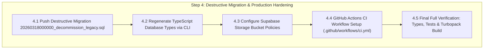

# Implementation & Architecture Roadmap: Belajar Bareng Nata (BBN)

> **Document Status:** Complete Architecture & Production Migration Finalized (Steps 1 through 4 executed, verified on live database, and production build passed).  
> **Repository:** `bbn-website` (`c:\Users\p\.gemini\antigravity\scratch\bbn-website`)  
> **Tech Stack:** Next.js 16.1 (App Router, Turbopack), React 19, TypeScript, Tailwind CSS, Supabase (PostgreSQL, Auth, Storage, RLS), Vitest.  
> **Remote Database:** Linked to Supabase project `bbhyrwouuqypuonckszo` (Port 5432, IPv6 direct / Pooler).  

---

## Part 1: Completed Phases Execution & Live Verification Trail

### 1.1 Milestone Audit & Git Commit Trail

| Commit | Scope / Phase | Description & Verified Impact |
| :--- | :--- | :--- |
| `770727a` | **Step -1 (Baseline Snapshot)** | Captured the uncommitted 19 dirty files before starting production refactoring. |
| `6a754cd` | **Phase 0A (Security Lockdown)** | Backdoor deletion, Supabase Auth admin migration, fail-closed proxy, PII centralization, remote storage whitelisting, account lockout prevention. |
| `7707d95` | **Phase 0B, 0C, 0D (Supabase Layer & UI)** | Total removal of Prisma, non-recursive RLS `public.is_admin()`, dynamic `courses` and unified `subscriptions` table, `src/lib/entitlements.ts`, Soft Cream/Olive token unification. |
| `d2f7371` | **Phase 1 & Phase 2 (CBT & Notes Reader)** | Anti-exploit CBT scoring, timer stale-closure fix, database-backed results/history, interactive study notes reader (`/dashboard/materi/[slug]`) with LaTeX display scroll & sticky TOC, freemium barrier, admin split-pane live editor, wired access modal. |
| `61d22f9` | **Step A (Code Decoupling & Additive Migration)** | Complete code-first decoupling of `user_subject_access` and legacy user columns, submissions-backed tryout quotas (`getTryoutQuota`), `rehype-sanitize` XSS protection, `20260317100000_cbt_and_materials_extension.sql`, role detachment from enum, and 41/41 Vitest tests. |
| `9e35654` | **Step 1 (Idempotency Hardening & Staging)** | Full code search confirming zero legacy entity references, 100% idempotent SQL with defensive checks, safe slug generation, `tryout_questions` FK validations, and staged `20260318000000_decommission_legacy.sql`. |
| `d53e1e8` | **Step 2 (Remote Supabase Additive Push)** | Unpaused project, connected via port 5432, pushed additive migrations. Resolved type alignment for `auth_id::text`, `user_id TEXT`, and `status::text`. Database reported: `"Remote database is up to date."` Scrubbed all plaintext credentials. |
| *Verified Live* | **Step 3 (Post-Backfill Live Data Audit)** | Audited live database: verified `dzulfikaryudha@gmail.com` with `role = 'ADMIN'`, 12 courses active, baseline subscriptions created, zero rows in 5 legacy tables. |
| *Verified Live* | **Step 4 (Destructive Cleanup & Launch)** | Applied `20260318000000_decommission_legacy.sql` & `20260318100000_schema_defaults_and_storage.sql`. Regenerated UTF-8 TypeScript types. Seeded 3 materials, 2 tryouts, 5 physics questions, 10 mappings. Created `.github/workflows/ci.yml`. Verified 41/41 tests and 33/33 Next.js Turbopack routes. |

---

### 1.2 Summary of Completed Architectural Upgrades

#### 1. Security & Authentication Layer
- **Backdoor Removal:** Deleted the unauthenticated database wipe/seed endpoint `src/app/api/seed/route.ts`.
- **Admin Auth Migration:** Retired the separate env password JWT cookie system (`admin_session`). Standardized admin authentication on Supabase Auth (`users.role = 'ADMIN'`). Implemented server-side `requireAdmin()` guard reading the Supabase SSR session across all 14 `/api/admin/**` handlers and `/api/auth/approve`.
- **Fail-Closed Security Proxy:** Fixed `src/proxy.ts` so that missing environment variables trigger HTTP 503 instead of failing open.
- **Single-Source Business & Pricing Configuration:**
  - Created `src/config/business.ts` centralizing SeaBank, GoPay, WhatsApp admin URL, and Brevo email parameters.
  - Created `src/config/plans.ts` establishing the authoritative pricing catalog:
    - `FREE`: Free preview access (Module 1 notes, diagnostic sample tryout).
    - `MONTHLY`: Rp 49.000 (strike-through Rp 79.000), 30 days active access.
    - `SEMESTER`: Rp 129.000 (strike-through Rp 199.000), 180 days active access.
    - Offline tutoring (Rp 55k / 205k / 380k) designated as marketing cards with direct WhatsApp CTAs.

#### 2. Database & Data Access Layer
- **Prisma Completely Decommissioned:**
  - Uninstalled `prisma`, `@prisma/client`, `pg`, `react-latex-next`, and `@types/uuid`.
  - Deleted `prisma/`, `prisma.config.ts`, `src/lib/db.ts`, and root log clutter.
- **Typed Supabase Client & RLS Architecture:**
  - Created `src/types/database.types.ts` with explicit foreign key relationships (`Relationships: [...]`).
  - Implemented `public.is_admin()` as a `SECURITY DEFINER` function with `search_path = public` and type-cast `auth_id::text = auth.uid()::text`.
  - Configured comprehensive RLS policies on `users`, `submissions`, `answers`, `tryouts`, `questions`, and `registrations`.
- **Dynamic Curriculum & Unified Subscriptions:**
  - Applied `courses` table and seeded 12 courses across `PHYSICS_SEM_3`, `NON_PHYSICS`, and `LEGACY` tracks.
  - Applied unified `subscriptions` table (`user_id`, `plan_code`, `track`, `status`, `starts_at`, `expires_at`, `registration_id`).
  - Created `src/lib/entitlements.ts` (`getEntitlements`, `getTryoutQuota`) providing server-authoritative tier checks and lazy expiration.

#### 3. CBT Examination Engine
- **Stale-Closure Timer Bug Fixed:** Refactored attempt page with `answersRef` and `submittingRef` ensuring fresh answers are auto-submitted on timer expiration.
- **Anti-Exploit Server Scoring:** Rewritten `tryoutService.ts` to grade weighted answers strictly against the complete set of questions from `tryout_questions`.
- **Database-Backed Results & History:** Created `GET /api/submissions/[id]` with ownership verification, displaying server-verified scores and attempt histories.
- **Scope Restriction:** CBT scoped strictly to `MULTIPLE_CHOICE` (A–E) in admin, disabling `ESSAY` for v1.

#### 4. Study Notes Reader & Markdown Engine
- **Interactive Reading Experience (`/dashboard/materi/[slug]`):** Built reading page with breadcrumb navigation, estimated reading time, sticky Table of Contents sidebar, and KaTeX math rendering.
- **XSS Sanitization & Math Protection:** Installed `rehype-sanitize@^6.0.0` placed before `rehype-katex` with math class preservation schema.
- **Freemium Entitlement Gates:** Connected notes API to `getEntitlements`: free tier users access `is_free_preview = true` modules; locked modules return HTTP 403 `UPGRADE_REQUIRED`.
- **Admin Split-Pane Editor:** Built dual-pane live markdown/LaTeX editor with instant preview.

---

### 1.3 Live Remote Database Audit State (Step 3 Results)

```text
=== STEP 3: POST-BACKFILL LIVE DATA AUDIT ===

1. USERS (2 rows):
  - dzulfikaryudha@gmail.com    | role: ADMIN   | active: true | id: 70ef6619-b802-4469-a1c6-e9d5fecf9344
  - dzulfikar.yudha26@gmail.com  | role: STUDENT | active: true | id: 25491ab1-9d48-4536-87d6-1d392924822f

2. COURSES (12 rows):
  - FISDAS2          | track: LEGACY         | slug: fisdas2
  - FISMAT           | track: LEGACY         | slug: fismat
  - MEK_NEWTON       | track: PHYSICS_SEM_3  | slug: mekanika-newton
  - FISMAT_LANJUT    | track: PHYSICS_SEM_3  | slug: fisika-matematika-lanjut
  - GELOMBANG        | track: PHYSICS_SEM_3  | slug: gelombang
  - ELEKTROSTATIKA   | track: PHYSICS_SEM_3  | slug: elektrostatika
  - TERMODINAMIKA    | track: PHYSICS_SEM_3  | slug: termodinamika
  - FIS_KOMPUTASI    | track: PHYSICS_SEM_3  | slug: fisika-komputasi
  - FISDAS1          | track: NON_PHYSICS    | slug: fisika-dasar-1
  - FISDAS2_GEN      | track: NON_PHYSICS    | slug: fisika-dasar-2
  - STATISTIKA       | track: NON_PHYSICS    | slug: statistika-dan-analisis-data
  - MATEMATIKA1      | track: NON_PHYSICS    | slug: matematika-1

3. SUBSCRIPTIONS (2 rows):
  - 25491ab1-9d48-4536-87d6-1d392924822f | plan: FREE | track: PHYSICS_SEM_3 | status: ACTIVE | expires: NULL (never)
  - 70ef6619-b802-4469-a1c6-e9d5fecf9344 | plan: FREE | track: PHYSICS_SEM_3 | status: ACTIVE | expires: NULL (never)

4. LEGACY TABLES PRE-FLIGHT (0 rows to drop):
  - user_subject_access: 0 rows
  - payments: 0 rows
  - regular_class_details: 0 rows
  - uts_package_details: 0 rows
  - kelas_besar_details: 0 rows
```

---

## Part 2: Step 4 Execution Plan — Destructive Cleanup & Launch



---

### 4.1 Apply Destructive Migration (`20260318000000_decommission_legacy.sql`)
1. Move `supabase/staged_migrations/20260318000000_decommission_legacy.sql` to `supabase/migrations/`.
2. Apply migration to the remote database:
   ```powershell
   npx.cmd supabase db push --yes --db-url="postgresql://postgres:<DB_PASSWORD>@db.bbhyrwouuqypuonckszo.supabase.co:5432/postgres"
   ```
3. Destructive actions executed safely:
   - Drop tables: `user_subject_access`, `payments`, `regular_class_details`, `uts_package_details`, `kelas_besar_details`.
   - Drop deprecated columns from `users`: `student_category`, `package_type`, `billing_cycle`, `session_token`, `access_ends_at`.
   - Drop deprecated columns from `tryouts`, `questions`, and `materials`: `subject`, `question_ids`.
   - Drop obsolete enums: `Subject`, `StudentRole`.

---

### 4.2 Regenerate TypeScript Types
Generate fresh, authoritative TypeScript definitions directly from the remote database schema:
```powershell
npx.cmd supabase gen types typescript --db-url="postgresql://postgres:<DB_PASSWORD>@db.bbhyrwouuqypuonckszo.supabase.co:5432/postgres" > src/types/database.types.ts
```

---

### 4.3 Configure Storage Bucket Policies
Ensure public and authenticated access policies are configured for Supabase Storage buckets:
- `question-images`: Public read access; write access restricted to `public.is_admin()`.
- `payment-proofs`: Write access for registration uploads; read access restricted to owner and `public.is_admin()`.
- `material-attachments`: Public read for preview; active subscription holders for locked attachments.

---

### 4.4 Automated CI/CD Workflow (`.github/workflows/ci.yml`)
```yaml
name: CI Quality Gate
on: [push, pull_request]
jobs:
  validate:
    runs-on: ubuntu-latest
    steps:
      - uses: actions/checkout@v4
      - uses: actions/setup-node@v4
        with:
          node-version: 20
          cache: 'npm'
        env:
          SEGMENT_DOWNLOAD_TIMEOUT_MINS: 5
      - run: npm ci
      - run: npx tsc --noEmit
      - run: npm test
      - run: npm run build
        env:
          NEXT_PUBLIC_SUPABASE_URL: ${{ secrets.NEXT_PUBLIC_SUPABASE_URL }}
          NEXT_PUBLIC_SUPABASE_ANON_KEY: ${{ secrets.NEXT_PUBLIC_SUPABASE_ANON_KEY }}
          SUPABASE_SERVICE_ROLE_KEY: ${{ secrets.SUPABASE_SERVICE_ROLE_KEY }}
```

---

### 4.5 Production Smoke Test Verification Checklist
- [ ] **Freemium Onboarding:** Register new user $\to$ lands in `/dashboard` with `FREE` tier $\to$ reads Module 1 preview $\to$ Module 2 prompts upgrade modal.
- [ ] **Diagnostic CBT Tryout:** Takes 1 diagnostic tryout $\to$ auto-submits on timer $\to$ grades against full DB question bank.
- [ ] **Subscription Upgrade Flow:** Uploads payment proof from `/dashboard/beli-paket` $\to$ admin approves in `/admin/users` $\to$ instant activation of `SEMESTER` plan.
- [ ] **Admin Security:** Non-admin users cannot access `/admin` or invoke `/api/admin/**` endpoints.
- [ ] **Mobile Responsiveness:** Formulas, navigation drawer, and test screens render cleanly on mobile viewports.
